
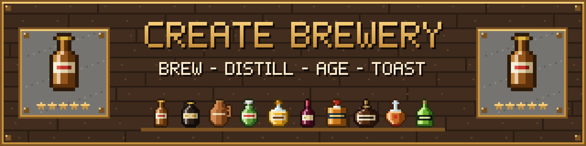

 

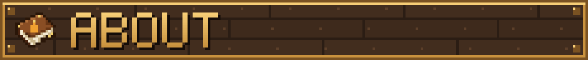

**Create Brewery** brings brewing, distilling and aging to [Create](https://modrinth.com/mod/create), in the spirit of the BreweryX plugin.
Build a brewery out of kettles, stills and barrels, wire it up with Create pipes and funnels, and find the recipes yourself. A well-tuned line always gives **5★** — every mistake costs stars.

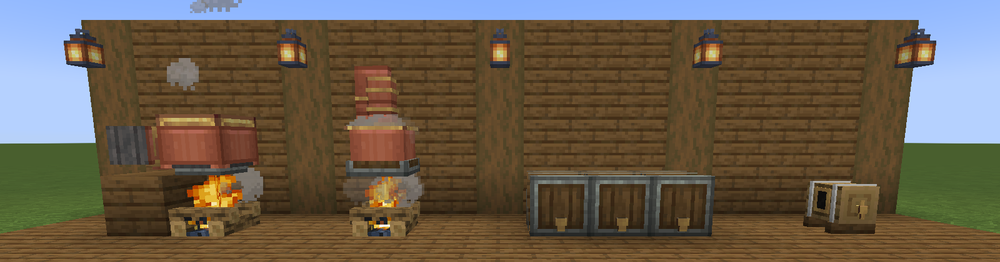

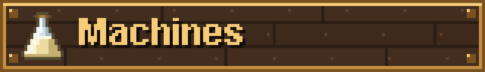

| Machine | What it does | What it needs |
|---|---|---|
| **Brewing Kettle** | Water + ingredients → wort | Fire below. Exact heating gives 5★, overheating 3★ |
| **Distillery** | Wort → distillate | Fire below and a shaft into the back port (4 SU per RPM). Two blocks tall |
| **Aging Barrel** | Distillate or young drink → aged drink | Wood in its slot and in-game days. Barrels side by side work as one, up to 384 bottles |
| **Bottling Spout** | Fills bottles from a neighbouring machine | A bottle in hand, or bottles through a funnel |
| **Keg** | Holds 8 portions of one drink and pours them into wooden mugs | Fill it by hand or with funnels; empties come out of the bottom |

Everything connects with Create pipes and funnels. Hold the **Ponder** key over any machine for an animated guide.

| 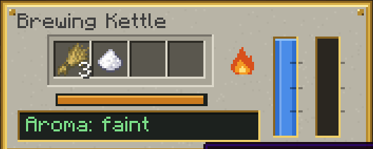 | 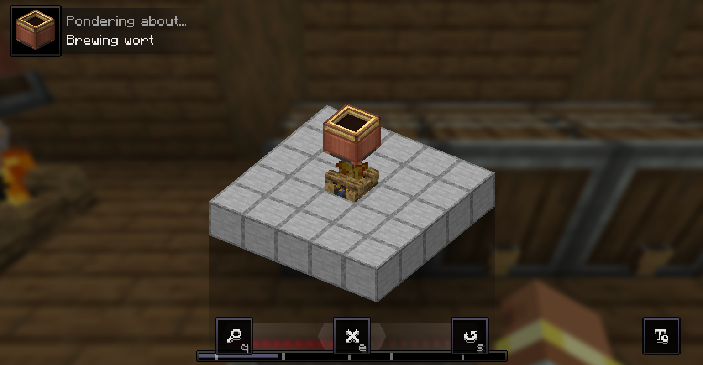 |
| --- | --- |

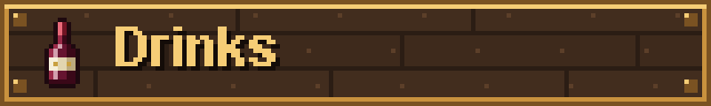

Beer, stout, kvass, cider, mead, wine, whiskey, vodka, rum, calvados, tequila, pulque, absinthe, firefly liqueur and more — each with its own vessel and effects.

**Nobody tells you the recipes.** The kettle brews any mix, and the closer it is to the real recipe, the more stars it gets. Still speed, aging time and barrel wood are found by feel too. Quality shows in the bottle tooltip, in the machine screens and in Create's goggles.

| 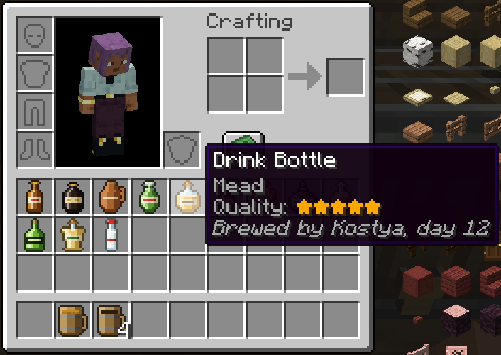 | 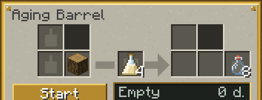 |
| --- | --- |

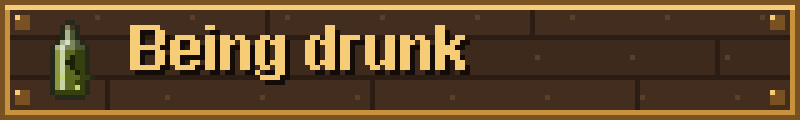

Every drink adds drunkenness by its strength.

- The camera sways, and chat speech starts to slur.
- Walking veers off course; a heavy drinker may throw up or pass out.
- Bad drinks leave a **hangover** once you sober up — a bottle of water or milk cures it.

Everything can be tuned or turned off in the server config.

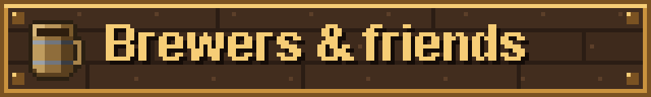

- **Brewer's signature** — every drink shows who brewed it and on which day.
- **Brewer's book** — a personal diary of your best results for every drink. Only its owner can read it; anyone else sees scribbles.
- **Toasts** — clink drinks with a friend (right-click): the next sip's effects last 50% longer with half the hangover.
- **Treating** — brewers earn advancements when other players drink their signed drinks.

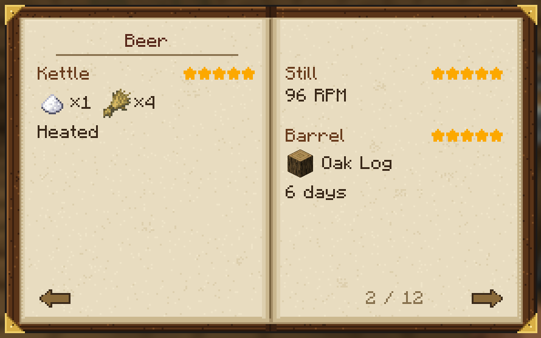

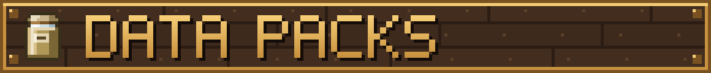

Recipes are data-driven: add your own drinks with stages, alcohol, still speed, aging days, wood and effects through a data pack.

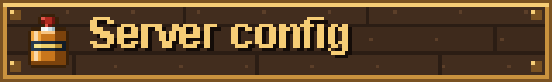

`brewery-server.toml` (also shown in the in-game config screen): staggering, vomiting, hangover, pass-out threshold, sober-up speed, drink effect multiplier, toast bonus.
On NeoForge and Forge it lives in the world's `serverconfig` folder, on Fabric in `config/`.

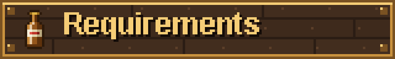

| Loader | Minecraft | Needs | Optional |
|---|---|---|---|
| NeoForge 21.1.235+ | 1.21.1 | [Create](https://modrinth.com/mod/create) 6.0.10+ | [JEI](https://modrinth.com/mod/jei) |
| Forge 47.3.30+ | 1.20.1 | [Create](https://modrinth.com/mod/create) 6.0.8+ | [JEI](https://modrinth.com/mod/jei) |
| Fabric Loader 0.17.2+ | 1.20.1 | [Fabric API](https://modrinth.com/mod/fabric-api), [Create Fabric](https://modrinth.com/mod/create-fabric) 6.0.7+ | [JEI](https://modrinth.com/mod/jei), [Mod Menu](https://modrinth.com/mod/modmenu) |

Install on **both the client and the server**. English and Russian translations included.

**Found a bug or have an idea?** Open an issue on [GitHub](https://github.com/onkos1412/create-brewery/issues). Licensed under MIT.

